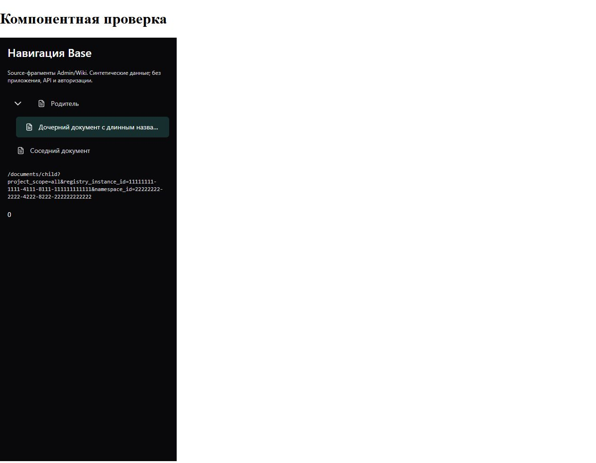

# Вложенная навигация Wiki
+
+Компонентная проверка AST-извлечённого DocumentNodes текущего source checkout
+с публичным Base SidebarList/nested. Данные и callbacks синтетические;
+приложение, API, Auth и установленный runtime не использовались.
+
+Dark, фактическая ширина iframe375px, comfortable density: gap6px,
+inset18px и цели нажатия44px. Матрица проверяет также light/gray,
+320/1920/2560px, три плотности, отсутствие overflow, Enter/Tab и
+один переход на каждое действие с сохранением namespace.
+
+
+